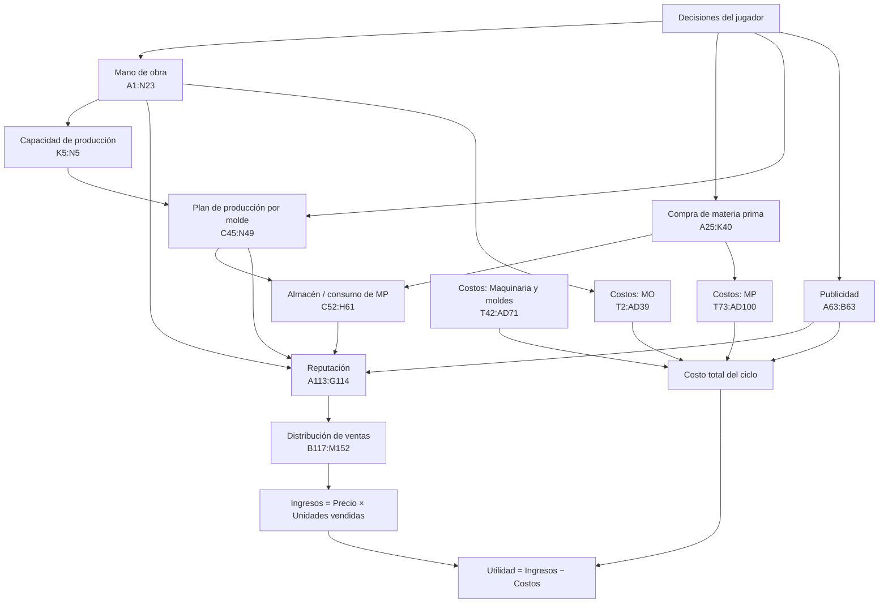

# Lógica del Excel SIDE – Hoja "Costos De Producción"

Documento base para construir el simulador SIDE a partir del archivo `DECISIONES SIDE 19.xlsx`.

> **Alcance**
> - Se explica la hoja **"Costos De Producción"** (la hoja "Copia de Costos De Producción" es idéntica, celda por celda).
> - Para **reputación y distribución de ventas** solo se usa el bloque **A113:N152** (las celdas B151/B152 con el mercado real de bolsos caros están 2 filas debajo de N150, pero son parte de la misma tabla).
> - El bloque de reputación y ventas de las filas **65 a 109 es un boceto y NO se usa**.
> - Las secciones de producción, mano de obra, materia prima, almacén y costos (filas 1–100) **sí se explican**, porque son las que alimentan el cálculo de reputación de la fila 113.
>
> Todos los valores de ejemplo que aparecen en este documento son los que tiene el Excel actualmente.

---

## 0. Mapa general de la hoja



La idea de SIDE en una frase: **el jugador decide personal, maquinaria, materiales, mezcla de producción, publicidad y precio; eso determina cuánto puede producir, cuánto le cuesta y qué reputación tiene; la reputación, el precio y la calidad determinan qué porción del mercado se lleva; las unidades vendidas por el precio dan los ingresos.**

---

## 1. Mano de obra y capacidad de producción (A1:N23)

### 1.1 Las tres áreas del proceso

Un bolso pasa por tres áreas en serie: **Corte → Ensamblado → Acabado**. En cada área el jugador decide cuántos trabajadores de cada nivel contrata.

| Nivel | Bolsos/día por trabajador (col. E) |
|---|---|
| Nivel 1 – básico | 6 |
| Nivel 2 – con experiencia | 8 |
| Nivel 3 – maestro / especializado | 12 |

**Área de corte (filas 5–8).** Solo hay una herramienta (mesa de corte), así que no hay multiplicador por maquinaria:

```
I5 = E5 × F5      (Nivel 1: 6 × 1 = 6)
I6 = E6 × F6      (Nivel 2: 8 × 1 = 8)
I7 = E7 × F7      (Nivel 3: 12 × 0 = 0)
I8 = SUMA(I5:I7) = 14 bolsos/día
```

**Área de ensamblado (filas 9–14) y acabado (filas 15–20).** Aquí cada trabajador se asigna a un tipo de máquina, que multiplica su productividad:

| Maquinaria | Columna | Multiplicador |
|---|---|---|
| Manual | F | 1.0 (F10 / F16) |
| Semiindustrial | G | 1.2 (G10 / G16) |
| Industrial | H | 1.5 (H10 / H16) |

```
Producción_nivel = Σ (n° trabajadores en la máquina × bolsos/día del nivel × multiplicador de la máquina)

Ensamblado:
  I11 (N1) = 1 trabajador industrial × 6 × 1.5 = 9
  I12 (N2) = 1 manual × 8 × 1.0            = 8
  I13 (N3) = 1 semiindustrial × 12 × 1.2   = 14.4
  I14 = 31.4 bolsos/día

Acabado:
  I17 (N1) = 0
  I18 (N2) = 1 industrial × 8 × 1.5 = 12
  I19 (N3) = 1 manual × 12 × 1.0    = 12
  I20 = 24 bolsos/día
```

### 1.2 Cuello de botella y producción real

```
K5 = MIN(I8, I14, I20) = MIN(14, 31.4, 24) = 14 bolsos/día   ← el área más lenta manda
L5 = K5 × 30 = 420 bolsos/mes (capacidad teórica del ciclo)
M5 = Eficiencia = K7 + (F7 + F13 + F19)/100 + 4% × F21
   = 0.90 (eficiencia base) + (0 + 0 + 1)/100 + 4% × 0 (jefe de producción)
   = 0.91
N5 = REDONDEAR(L5 × M5) = REDONDEAR(420 × 0.91) = 382 bolsos (capacidad real)
```

Reglas de negocio:
- **Eficiencia base 90%.** Cada trabajador de nivel 3 suma +1 punto, y contratar un **jefe de producción (F21)** suma +4 puntos.
- La nota de O5 dice que **la producción no puede superar lo que permite el material** → la producción real será el mínimo entre capacidad (N5) y lo que alcanzan los materiales (ver sección 3).

> ⚠️ **Observación para el simulador:** en M5 solo se suman F13 y F19 (trabajadores N3 en maquinaria **manual**). Un N3 en semiindustrial o industrial (G13, H13, G19, H19) no suma eficiencia. En el ejemplo hay un N3 en G13 que no se cuenta. Lo coherente es usar `SUMA(F7, F13:H13, F19:H19)`, igual que en L10.

### 1.3 Indicadores de personal para reputación

```
L9  = Total de trabajadores = SUMA(F5:F7, F11:H13, F17:H19) = 7
L10 = Trabajadores nivel 3  = SUMA(F7, F13:H13, F19:H19)    = 2
M10 = L10 / L9 = 2/7 = 0.2857   ← "Factor de MO" (se usa en reputación)
```

---

## 2. Compra de materia prima (A25:K40)

### 2.1 Catálogo de materiales y niveles

| Familia | Nivel 1 | Nivel 2 | Nivel 3 |
|---|---|---|---|
| Cuero (D–F) | Sintético | Genuino estándar | Genuino premium |
| Accesorios (G–H) | Aleación económica | Metal premium | — |
| Hilo (I–K) | Poliéster estándar | Encerado reforzado | Alta tenacidad (nylon trenzado) |

### 2.2 Unidad de compra vs unidad de producción

El jugador compra en una unidad (rollo, piel, juego, carrete) y la producción consume en otra (m², unidad, metro).

```
Fila 29: UM Compra       → rollo | piel completa | juego | carrete
Fila 30: UM Producción   → m²    | m²            | unidad | metro
Fila 31: Compra Jugador  → cantidad comprada en UM de compra (decisión)
Fila 32: Factor conversión → cuántas UM de producción trae cada UM de compra
Fila 33: = Fila 31 × Fila 32 → total disponible en UM de producción
```

Ejemplo actual:

| Material | Compra (31) | Factor (32) | Disponible (33) |
|---|---|---|---|
| Cuero sintético | 60 rollos | 1 m² | 60 m² |
| Cuero genuino estándar | 55 pieles | 2 m² | 110 m² |
| Cuero premium | 15 pieles | 2 m² | 30 m² |
| Accesorios económicos | 200 juegos | 1 | 200 u |
| Accesorios premium | 190 juegos | 1 | 190 u |
| Hilo poliéster | 0 carretes | 270 m | 0 m |
| Hilo encerado | 6 carretes | 250 m | 1,500 m |
| Hilo alta tenacidad | 7 carretes | 200 m | 1,400 m |

Totales por familia (fila 38): **Cuero 200 m² (H38), Accesorios 390 u (I38), Hilo 2,900 m (J38).**

### 2.3 Moldes = receta de consumo por bolso (C37:F40)

El molde define **cuánto material consume un bolso** y el tipo de bolso. Regla: siempre se debe comprar al menos un molde.

| Molde | Cuero (m²/bolso) | Accesorios (u/bolso) | Hilo (m/bolso) |
|---|---|---|---|
| Nivel 1 – Genérico básico | 0.3 | 1 | 6 |
| Nivel 2 – Genérico mejorado | 0.4 | 1 | 7 |
| Nivel 3 – Premium | 0.7 | 1 | 13 |

> Supuesto de mapeo hacia el mercado (sección 6): **Molde 1 → Bolsos económicos, Molde 2 → Bolsos medios, Molde 3 → Bolsos caros.** El Excel no lo vincula explícitamente; conviene dejarlo explícito en el simulador.

> 📝 Las notas B42–B43 del propio Excel sugieren manejar el hilo como unidad con valores más pequeños y bajar su precio (hoy el hilo es el insumo más caro, ver sección 5.3).

---

## 3. Plan de producción y almacén (C45:H61)

### 3.1 Plan de producción por molde (C45:N49)

```
D = Bolsos que el jugador DESEA producir (decisión)
E = Bolsos realmente producidos al terminar el ciclo
F = Mezcla de producción = E_nivel / E_total
H, I, J = Material NECESARIO para lo deseado  (D × receta)
L, M, N = Material UTILIZADO en lo producido   (E × receta)
```

| Molde | Deseado (D) | Producido (E) | Mezcla (F) | Cuero nec. | Acc. nec. | Hilo nec. | Cuero usado | Acc. usado | Hilo usado |
|---|---|---|---|---|---|---|---|---|---|
| N1 | 150 | 150 | 40.8% | 45 | 150 | 900 | 45 | 150 | 900 |
| N2 | 140 | 140 | 38.0% | 56 | 140 | 980 | 56 | 140 | 980 |
| N3 | 95 | **78** | **21.2%** | 66.5 | 95 | 1,235 | 54.6 | 78 | 1,014 |
| **Total** | 385 | **368** | 100% | 167.5 | 385 | **3,115** | 155.6 | 368 | 2,894 |

**Por qué se produjeron 78 premium y no 95:** el jugador quería 385 bolsos, pero:
1. Capacidad real (N5) = 382 → limita a 382.
2. Hilo necesario = 3,115 m > hilo disponible = 2,900 m → **el hilo es el cuello de botella**.
3. Se produce primero N1 y N2 completos (900 + 980 = 1,880 m de hilo) y con el hilo restante (1,020 m ÷ 13 m/bolso = 78.4) solo salen **78 premium**.

En el Excel, la columna E está escrita a mano. **En el simulador debe calcularse:**

```
Para cada molde, en orden N1 → N2 → N3:
  max_por_cuero  = cuero_restante  / receta_cuero
  max_por_acc    = acc_restante    / receta_acc
  max_por_hilo   = hilo_restante   / receta_hilo
  max_por_capac  = capacidad_restante
  E_nivel = PISO(MIN(D_nivel, max_por_cuero, max_por_acc, max_por_hilo, max_por_capac))
  descontar del restante lo usado
```

(El orden de prioridad N1 → N2 → N3 replica el resultado del Excel; podría hacerse configurable.)

`F48 = E48 / E49 = 78/368 = 0.212` → **"Factor de producción"** de la reputación (proporción de bolsos premium).

### 3.2 Almacén de materia prima (C52:H61)

Fórmula de inventario (H35): **Inventario final = Inventario inicial + Compras − Consumo**

```
D = Inventario inicial (del ciclo anterior; hoy 0)
E = Compras = fila 33
F = Consumo  → se consume primero el nivel más BAJO de cada familia:
      Cuero:   F54 = MIN(E54, H49)
               F55 = MIN(E55, H49 − F54)
               F56 = MIN(E56, H49 − F54 − F55)
      Accesorios y Hilo: misma lógica con I49 y J49
G = Inventario final = D + E − F
```

Resultado del ejemplo:

| Material | Compras | Consumo | Inv. final |
|---|---|---|---|
| Cuero sintético | 60 | 60 | 0 |
| Cuero genuino estándar | 110 | 107.5 | 2.5 |
| Cuero premium | 30 | **0** | 30 |
| Acc. económico | 200 | 200 | 0 |
| Acc. premium | 190 | 185 | 5 |
| Hilo poliéster | 0 | 0 | 0 |
| Hilo encerado | 1,500 | 1,500 | 0 |
| Hilo alta tenacidad | 1,400 | 1,400 | 0 |

**Implicancia de diseño importante:** la calidad del material no depende del molde, sino del orden de consumo. Como se gasta primero lo barato, el material premium solo se usa si lo barato no alcanza. Por eso en el ejemplo se compraron 30 m² de cuero premium y no se usó nada.

### 3.3 Indicadores de utilización de material premium (para reputación)

```
H56 = Cuero premium consumido / Cuero total consumido      = 0 / 167.5            = 0.000
H58 = Acc. premium consumido  / Acc. total consumido       = 185 / 385            = 0.4805
H61 = Hilo N3 consumido       / (Hilo N2 + N3 consumido)   = 1,400 / 2,900        = 0.4828
```

> ⚠️ **Observaciones para el simulador:**
> - El consumo usa H49/I49/J49 (material **necesario** para lo deseado) y no L49/M49/N49 (material **utilizado** en lo producido). Debe usarse lo utilizado; si no, se descuenta del almacén material de bolsos que nunca se fabricaron (aquí 167.5 m² de cuero en vez de 155.6).
> - El MIN de consumo solo mira las compras (E), no el inventario inicial (D). Debe ser `MIN(D + E, …)`.
> - H61 excluye el hilo N1 del denominador (H56 y H58 sí incluyen todos los niveles). Para ser consistente: `H61 = F61 / SUMA(F59:F61)`.

---

## 4. Publicidad (A62:B63)

```
B63 = Gasto en publicidad del ciclo (decisión), rango 0 – 10,000 soles. Ejemplo: 3,000.
```

Entra en dos lugares: como **costo del ciclo** y como **factor de reputación**.

---

## 5. Costos (T2:AD100)

### 5.1 Mano de obra (T2:AD39)

Cada puesto tiene dos regímenes laborales: **MYPE** y **No MYPE**. El costo se construye así:

```
Essalud      = Sueldo × 9%
Gratificación= Sueldo (MYPE)        | Sueldo × 2 (No MYPE)
CTS          = fijo 750 (MYPE)      | 1,500 (No MYPE)   ← la mayoría están "a mano"
Vacaciones   = Sueldo / 2 (MYPE)    | Sueldo (No MYPE)
Suma anual   = Essalud + Grati + CTS + Vacaciones + Sueldo × 12
Pago mensual = Suma anual / 12.5 (MYPE)  | Suma anual / 13 (No MYPE)
```

| Área | Nivel 1 | Nivel 2 | Nivel 3 |
|---|---|---|---|
| Corte | Operario básico – S/1,500 | Cortador con experiencia – S/2,000 | Maestro cortador – S/3,800 |
| Ensamblado | Costurero básico – S/1,500 | Maquinista industrial – S/2,800 | Marroquinero especializado – S/4,500 |
| Acabado | Op. de acabado clásico – S/1,500 | Técnico de acabado – S/2,800 | Artesano acabador – S/4,500 |

| Puesto (sueldo base) | Pago mensual MYPE | Pago mensual No MYPE |
|---|---|---|
| Sueldo 1,500 | 1,690.80 | 1,856.54 |
| Cortador con experiencia (2,000) | 2,254.40 | 2,475.38 |
| Sueldo 2,800 | 3,104.16 | 3,365.54 |
| Maestro cortador (3,800) | 4,191.36 | 4,526.31 |
| Sueldo 4,500 | 4,952.40 | 5,338.85 |

**Personal indirecto y fijo:**

| Concepto | Base | Mensual MYPE | Mensual No MYPE |
|---|---|---|---|
| Jefatura (jefe de producción) | 3,000 | 3,321.60 | 3,597.69 |
| Limpieza | 600 | 712.32 | 811.85 |
| Local de producción (costo fijo) | 2,000 | 2,000 | 2,000 |

> ⚠️ El "Cortador con experiencia" calcula CTS con fórmula (`U14/2` = 1,000 / `V14` = 2,000), mientras el resto la tiene fija en 750/1,500. Conviene unificar la regla de CTS.

**Costo MO del ciclo = Σ (n° trabajadores del puesto × pago mensual del puesto) + jefatura (si F21 > 0) + limpieza + local.**

### 5.2 Maquinaria y moldes (T42:AD71)

Cada activo tiene un costo de adquisición y costos asociados en % de ese valor:

| Concepto | MYPE | No MYPE |
|---|---|---|
| Instalación | 3% | 5% |
| Capacitación | 2% (moldes 1%) | 3% (moldes 2%) |
| Mantenimiento anual | 5% | 8% |
| Valor residual (para depreciar) | 5% | 10% |
| Depreciación anual | (Costo − residual) / vida útil | |

| Activo | Costo | Vida útil |
|---|---|---|
| Mesa de corte | 2,500 | 10 años |
| Máquina ensamblado N1 / N2 / N3 | 3,500 / 7,500 / 15,000 | 10 años |
| Máquina acabado N1 / N2 / N3 | 1,200 / 4,500 / 9,500 | 8 años |
| Molde 1 / 2 / 3 | 300 / 1,200 / 3,500 | 5 años |

Relación con la producción: **Manual = máquina N1, Semiindustrial = N2, Industrial = N3** (multiplicadores 1.0 / 1.2 / 1.5 de la sección 1).

```
Suma anual = Costo adquisición + Instalación + Capacitación + Mantenimiento − Depreciación
```

> ⚠️ **Observación contable:** el Excel resta la depreciación del costo. Para el simulador se recomienda separar:
> - **Inversión (una sola vez, al comprar):** adquisición + instalación + capacitación → sale de caja, va al activo.
> - **Gasto por ciclo:** mantenimiento/12 + depreciación/12 → entra al estado de resultados.

### 5.3 Materia prima (T73:AD100)

**Lista de precios (T76:X83)** con **8% de descuento por cantidad**:

| Material | Precio lista | Precio con descuento | Unidad |
|---|---|---|---|
| Cuero sintético | 25 | 23.00 | m² |
| Cuero genuino estándar | 45 | 41.40 | m² |
| Cuero genuino premium | 80 | 73.60 | m² |
| Accesorios aleación económica | 4 | 3.68 | unidad |
| Accesorios metal premium | 9 | 8.28 | unidad |
| Hilo poliéster | 2 | 1.84 | m |
| Hilo encerado reforzado | 4 | 3.68 | m |
| Hilo alta tenacidad | 7 | 6.44 | m |

**Tres valorizaciones del inventario:**

```
Compras (T86:X95)     = Σ cantidad disponible (fila 33) × precio   → 27,160 lista | 24,987.20 con desc.
Consumo (Z86:AD96)    = Σ cantidad consumida (col. F almacén) × precio → 24,580 | 22,613.60
Inv. final (T100:W100)= Compras − Consumo                          → 2,580 | 2,373.60
```

- **Costo de MP del ciclo (estado de resultados) = Consumo valorizado = 22,613.60**
- **Salida de caja por MP = Compras = 24,987.20**
- **Activo en almacén = 2,373.60** (pasa como inventario inicial al siguiente ciclo)

Detalle del consumo: cuero 1,380 + 4,429.80 (107 m² escritos a mano; el almacén dice 107.5) + 0; accesorios 736 + 1,531.80; hilo 0 + 5,520 + 9,016. **El hilo representa el 64% del costo de MP**, lo que respalda la nota del Excel de bajar su precio.

> ⚠️ La tabla Z74:AD84 ("Lo que sea comprado por un equipo") multiplica el cuero genuino por 55 m² en vez de 110 m² (no aplica el factor de conversión de la fila 32). La tabla correcta es la de T86:X95.

**Costo unitario de MP por bolso** (para el simulador):
```
Costo_MP_bolso = receta_cuero × precio_cuero_consumido
               + receta_acc   × precio_acc_consumido
               + receta_hilo  × precio_hilo_consumido
```

---

## 6. Reputación (A113:G114)  ✅ bloque oficial

La reputación resume qué tan "buena" es la empresa. Tiene **4 factores, cada uno en escala 0–10**, que se suman (total 0–40):

```
C113  Factor de producción          = F48 × 10                        = 0.2120 × 10 = 2.12
D113  Factor de mano de obra        = M10 × 10                        = 0.2857 × 10 = 2.86
E113  Factor de MP (utilización)    = PROMEDIO(H56, H58, H61) × 10    = 0.3211 × 10 = 3.21
F113  Factor de publicidad          = B63 / 10,000 × 10               = 0.30   × 10 = 3.00
G113  REPUTACIÓN TOTAL              = SUMA(C113:F113)                               = 11.19 ptos
```

| Factor | Qué premia | Cómo subirlo |
|---|---|---|
| Producción | % de bolsos premium (molde N3) en lo producido | Producir más bolsos con molde 3 |
| Mano de obra | % de trabajadores nivel 3 | Contratar maestros/especialistas |
| MP (utilización) | % de material premium realmente **consumido** (cuero, accesorios, hilo) | Comprar material premium **y** que se consuma (no basta con comprarlo) |
| Publicidad | Gasto en publicidad sobre el tope de 10,000 | Invertir en publicidad |

> ⚠️ **Escala:** G113 va de 0 a 40, pero las tablas de ventas esperan "Reputación (0–10)". Para conectarlos el simulador debe usar **Reputación_0_10 = G113 / 4** (o promediar los factores). En el ejemplo: 11.19 / 4 = **2.80**. Los valores de prueba de las tablas (7, 8.3, 10.2, 9) son ingresados a mano, y 10.2 incluso supera 10.
>
> Sugerencia: acotar la publicidad con `MIN(B63, 10000)` para que el factor no pase de 10.

---

## 7. Distribución de ventas (B117:M152)  ✅ bloque oficial

### 7.1 Tamaño de mercado

Cada segmento tiene un mercado total y un % que realmente se reparte entre las empresas:

| Segmento | Mercado total | % real | Mercado real (a repartir) |
|---|---|---|---|
| Económico | 7,000 (B124) | 50% (B125) | **3,500** (B126) |
| Medio | 5,000 (B137) | 70% (B138) | **3,500** (B139) |
| Caro | 2,000 (B150) | 40% (B151) | **800** (B152) |

> ⚠️ B126, B139 y B152 están escritos a mano. En el simulador: `Mercado_real = Mercado_total × %_real`.

### 7.2 Pesos de compra por segmento

Cada tipo de cliente valora distinto el precio, la reputación y la calidad (cada trío suma 1):

| Segmento | Peso precio | Peso reputación | Peso calidad |
|---|---|---|---|
| Económico (M114:M116) | **0.70** | 0.20 | 0.10 |
| Medio (M127:M129) | 0.40 | 0.35 | 0.25 |
| Caro (M140:M142) | 0.10 | **0.50** | 0.40 |

Lógica: el cliente económico compra por precio; el cliente de lujo compra por marca (reputación) y calidad.

### 7.3 Paso a paso del cálculo (igual para los tres segmentos)

Para cada empresa *i* del segmento:

**Paso 1 – Datos de entrada:** Precio (C) y Reputación 0–10 (D).

**Paso 2 – Puntaje de calidad 0–100 (E):**
```
E_i = REDONDEAR( D_i / SUMA(D de todas) × 100 )
```
> ⚠️ Hoy la "calidad" es la participación de la empresa en la reputación total, no una calidad real del producto, y las tres tablas dividen entre **D122** (la suma del segmento económico). Además, con 4 empresas este puntaje ronda 25, no 0–100. Recomendación: calcular la calidad real del bolso a partir del material consumido y del molde, por ejemplo `Calidad = (factor MP + factor producción) / 20 × 100`, o normalizarla min-max como el precio.

**Paso 3 – Puntaje de precio 0–100 (F).** Aquí cambia según el segmento:

*Económico — "más barato, mejor" (normalización min-max):*
```
F_i = 100 × (P_max − P_i) / (P_max − P_min)
```
El más barato obtiene 100, el más caro 0, el resto proporcional.
> ⚠️ Si todas las empresas ponen el mismo precio hay división entre cero → en ese caso asignar 100 a todas.

*Medio y Caro — "cercanía al precio ideal":*
```
F_i = 100 − |P_i − Precio_ideal| / Precio_ideal × 100
Precio ideal: Medio = 100 (M130) | Caro = 250 (M143)
```
Se castiga alejarse del precio ideal tanto por arriba como por abajo (un bolso de lujo demasiado barato también "pierde").
> ⚠️ Si el precio se aleja más del 100% del ideal (ej. Medio a 210), el puntaje sale **negativo**. Usar `MAX(0, …)`.

**Paso 4 – Reputación 0–100 (G):**
```
G_i = D_i × 10
```

**Paso 5 – Puntaje total (H):**
```
H_i = Peso_precio × F_i + Peso_reputación × G_i + Peso_calidad × E_i
```

**Paso 6 – Participación de mercado (I):**
```
I_i = H_i / SUMA(H de todas)
```

**Paso 7 – Unidades vendidas (J):**
```
J_i = REDONDEAR( I_i × Mercado_real )
```

### 7.4 Resultados del ejemplo

**Bolsos económicos** (mercado real 3,500; P_min 40, P_max 45)

| Empresa | Precio | Rep. | Calidad | Pje. precio | Rep. 0–100 | Total | % | **Unidades** |
|---|---|---|---|---|---|---|---|---|
| A | 40 | 7.0 | 20 | 100 | 70 | 86.0 | 36.9% | **1,292** |
| B | 45 | 8.3 | 24 | 0 | 83 | 19.0 | 8.2% | **285** |
| C | 43 | 10.2 | 30 | 40 | 102 | 51.4 | 22.1% | **772** |
| D | 41 | 9.0 | 26 | 80 | 90 | 76.6 | 32.9% | **1,151** |
| | | | | | | 233.0 | 100% | 3,500 |

Lectura: B tiene buena reputación pero, al ser el más caro, en este segmento se queda con solo 8%. Con 5 soles de diferencia el puntaje de precio va de 100 a 0: **el segmento económico es extremadamente sensible al precio**.

**Bolsos medios** (mercado real 3,500; precio ideal 100)

| Empresa | Precio | Rep. | Calidad | Pje. precio | Rep. 0–100 | Total | % | **Unidades** |
|---|---|---|---|---|---|---|---|---|
| A | 120 | 7.0 | 20 | 80 | 70 | 61.50 | 30.5% | **1,067** |
| B | 150 | 8.3 | 24 | 50 | 83 | 55.05 | 27.3% | **955** |
| C | 190 | 10.2 | 30 | 10 | 102 | 47.20 | 23.4% | **819** |
| D | 200 | 9.0 | 26 | 0 | 90 | 38.00 | 18.8% | **659** |
| | | | | | | 201.75 | 100% | 3,500 |

**Bolsos caros** (mercado real 800; precio ideal 250)

| Empresa | Precio | Rep. | Calidad | Pje. precio | Rep. 0–100 | Total | % | **Unidades** |
|---|---|---|---|---|---|---|---|---|
| A | 250 | 7.0 | 20 | 100 | 70 | 53.0 | 21.8% | **174** |
| B | 300 | 8.3 | 24 | 80 | 83 | 59.1 | 24.3% | **194** |
| C | 220 | 10.2 | 30 | 88 | 102 | 71.8 | 29.5% | **236** |
| D | 400 | 9.0 | 26 | 40 | 90 | 59.4 | 24.4% | **195** |
| | | | | | | 243.3 | 100% | **799** |

Lectura: en el segmento caro gana C (mejor reputación), aunque A tiene el precio ideal exacto. D, con precio 60% sobre el ideal, aún vende casi lo mismo que B gracias a su reputación.

> ⚠️ **Redondeo:** en el segmento caro se reparten 799 en vez de 800. Usar el método de **restos mayores**: asignar `PISO(I × M)` a cada uno y repartir las unidades sobrantes a las empresas con mayor parte decimal.

### 7.5 Lo que el Excel no hace y el simulador SÍ debe hacer: tope por inventario

Las unidades del paso 7 son **demanda asignada**, no ventas. Una empresa no puede vender más de lo que tiene:

```
Unidades_vendidas_i = MIN( Demanda_asignada_i , Inventario_PT_inicial_i + Producción_i )
Demanda_insatisfecha_i = Demanda_asignada_i − Unidades_vendidas_i
Inventario_PT_final_i  = Inventario_PT_inicial_i + Producción_i − Unidades_vendidas_i
```

Opcional (más realista): la demanda insatisfecha se **redistribuye** entre las empresas que aún tienen stock, en proporción a su puntaje H, y se repite hasta que no quede demanda o stock.

Ejemplo con la empresa del Excel actuando como "Empresa A":

| Segmento | Demanda asignada | Producido | **Vendido** | Demanda perdida |
|---|---|---|---|---|
| Económico (molde 1) | 1,292 | 150 | **150** | 1,142 |
| Medio (molde 2) | 1,067 | 140 | **140** | 927 |
| Caro (molde 3) | 174 | 78 | **78** | 96 |

---

## 8. Ingresos

El Excel **no tiene una celda de ingresos**; se derivan así:

```
Ingreso_segmento_i = Precio_segmento_i × Unidades_vendidas_segmento_i
Ingreso_total_i    = Σ segmentos
```

**Ingreso potencial** (si cada empresa pudiera atender toda su demanda asignada):

| Empresa | Económico | Medio | Caro | **Total** |
|---|---|---|---|---|
| A | 40 × 1,292 = 51,680 | 120 × 1,067 = 128,040 | 250 × 174 = 43,500 | **223,220** |
| B | 45 × 285 = 12,825 | 150 × 955 = 143,250 | 300 × 194 = 58,200 | **214,275** |
| C | 43 × 772 = 33,196 | 190 × 819 = 155,610 | 220 × 236 = 51,920 | **240,726** |
| D | 41 × 1,151 = 47,191 | 200 × 659 = 131,800 | 400 × 195 = 78,000 | **256,991** |

Nótese que **vender más unidades no implica más ingresos**: D vende menos que A en total pero factura más porque cobra precios altos donde su reputación lo sostiene. Este es el *trade-off* central del juego.

**Ingreso real** de la empresa del Excel (topado por su producción de 368 bolsos):

```
Económico: 150 × 40  =  6,000
Medio:     140 × 120 = 16,800
Caro:       78 × 250 = 19,500
TOTAL                 = 42,300
```

---

## 9. Estado de resultados del ciclo (propuesta para el simulador)

Con los datos actuales del Excel, régimen **MYPE**, ciclo = 1 mes:

| Concepto | Cálculo | Monto (S/) |
|---|---|---|
| **Ingresos** | Sección 8 | **42,300.00** |
| MP consumida | Z86:AD96 con descuento | −22,613.60 |
| MO directa | 7 trabajadores (ver abajo) | −21,749.12 |
| Personal indirecto + local | Limpieza 712.32 + Local 2,000 (sin jefe, F21 = 0) | −2,712.32 |
| Mantenimiento maquinaria | Σ mantenimiento anual / 12 | −184.17 |
| Depreciación | Σ depreciación anual / 12 | −410.68 |
| Publicidad | B63 | −3,000.00 |
| **Utilidad operativa** | | **−8,369.88** |

MO directa del ejemplo: operario básico corte (1,690.80) + cortador con experiencia (2,254.40) + costurero básico (1,690.80) + maquinista industrial (3,104.16) + marroquinero especializado (4,952.40) + técnico de acabado (3,104.16) + artesano acabador (4,952.40).

Activos asumidos para mantenimiento/depreciación: mesa de corte, ensamblado N1, N2 y N3, acabado N1 y N3, moldes 1, 2 y 3 (inversión total S/ 44,200 + instalación 1,176 + capacitación 834, que se registran como inversión inicial, no como gasto del ciclo).

**Lectura:** la empresa pierde porque **produce 368 bolsos cuando el mercado le asignaba 2,533**. Su cuello de botella es el área de corte (14 bolsos/día) y el hilo. El simulador debe hacer visible esta relación entre capacidad, demanda y rentabilidad.

> Este estado de resultados es una propuesta: el Excel tiene todas las piezas pero no las consolida.

---

## 10. Secuencia de cálculo de un ciclo (pseudocódigo)

```text
PARA CADA empresa:
  1. Leer decisiones: trabajadores por área/nivel/máquina, jefe, régimen (MYPE/No MYPE),
     compras de MP, bolsos deseados por molde, publicidad, precio por segmento.
  2. Capacidad:
       prod_area = Σ trabajadores × bolsos_dia_nivel × multiplicador_maquina
       cap_dia   = MIN(corte, ensamblado, acabado)
       eficiencia= 0.90 + 0.01 × n°N3 + 0.04 × jefe
       capacidad = REDONDEAR(cap_dia × 30 × eficiencia)
  3. Material disponible = inventario_inicial + compras × factor_conversion
  4. Producción real por molde (N1→N2→N3) = MIN(deseado, capacidad, material) [sección 3.1]
  5. Consumo de MP: por familia, consumir primero el nivel más bajo  [sección 3.2]
     Inventario MP final = inicial + compras − consumo
  6. Reputación (0–40) = 10×%premium + 10×%N3 + 10×prom(%MP premium) + 10×MIN(pub,10000)/10000
     Reputación_0_10 = Reputación / 4

PARA CADA segmento (Económico, Medio, Caro):
  7. Puntajes de precio, reputación y calidad de cada empresa       [sección 7.3]
  8. Puntaje total ponderado → participación → demanda asignada (restos mayores)
  9. Ventas = MIN(demanda, stock de producto terminado) (+ redistribución opcional)

PARA CADA empresa:
 10. Ingresos = Σ precio × ventas
 11. Costos  = MP consumida + MO + indirectos + mantenimiento + depreciación + publicidad
 12. Utilidad = Ingresos − Costos
 13. Pasar al siguiente ciclo: inventario de MP, inventario de producto terminado,
     activos, (opcional) reputación acumulada.
```

---

## 11. Resumen de ajustes recomendados al pasar del Excel al simulador

| # | Dónde | Problema | Ajuste |
|---|---|---|---|
| 1 | M5 | Solo cuenta N3 en maquinaria manual | Usar `SUMA(F7, F13:H13, F19:H19)` |
| 2 | E46:E48 | Producción real escrita a mano | Calcularla con restricción de capacidad y material |
| 3 | F54:F61 | Consume material de lo deseado, no de lo producido; ignora inventario inicial | Usar L49:N49 y `D + E` |
| 4 | H61 | Denominador excluye hilo N1 | `F61 / SUMA(F59:F61)` |
| 5 | G113 vs D118 | Escala 0–40 vs 0–10 | Reputación_0_10 = G113 / 4 |
| 6 | F113 | Publicidad sin tope | `MIN(B63, 10000)` |
| 7 | E118:E147 | "Calidad" = cuota de reputación y siempre sobre D122 | Calidad real del producto, normalizada por segmento |
| 8 | F118:F121 | División entre cero si todos los precios son iguales | Caso especial → 100 |
| 9 | F131:F147 | Puntaje de precio puede ser negativo | `MAX(0, …)` |
| 10 | J118:J147 | Redondeo pierde unidades (799 de 800) | Método de restos mayores |
| 11 | J118:J147 | Ventas no se limitan al inventario | `MIN(demanda, stock)` + redistribución |
| 12 | B126, B139, B152 | Mercado real escrito a mano | `Mercado_total × %_real` |
| 13 | — | No hay cálculo de ingresos ni utilidad | Agregar secciones 8 y 9 |
| 14 | U50:AD71 | Depreciación restada del costo de adquisición | Separar inversión de gasto por ciclo |
| 15 | U17 / Z74:AD84 | CTS inconsistente; tabla de compras sin factor de conversión | Unificar regla de CTS; usar T86:X95 |
