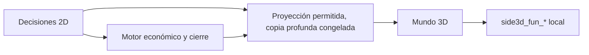

# Separación 2D / 3D — 23 octubre 2026

## Fase 0 y plan consolidado antes de modificar código

Base: commit 18d88e7, rama main, remoto https://github.com/valenlysm29/SIDE1.git. Árbol inicialmente limpio. Se leyeron reports/ y docs/ actuales; auditorías A/B/C paralelas, solo lectura. Node previo: 623/623, cero fallos (tests/output/separacion-20261023/node-before.tap). Navegador previo en ejecución.

| Dependencia encontrada (líneas de la base) | Lectura/escritura | Riesgo y acción prevista |
|---|---|---|
| simulator3d.js:113–129; app.js:538–563 SIDE_GAME_BRIDGE, caja y ciclo globales | Lecturas económicas vivas | Sustituir por snapshot profundo congelado; navegación separada |
| simulator3d.js:193–209,639,698–701,1629–1630,3268 | Caja, crédito, finanzas y productividad mezclados con recreación | Retirar llamadas y cifras financieras de la UI recreativa |
| simulator3d.js:140–145,167,219–287,2380–2382 | Escrituras locales side3d_* | Namespace explícito side3d_fun_*; nunca tablas económicas |
| simulator3d.js:229–275,231–237,4120 | Plan productivo vivo; exposición de producción recreativa | Solo proyección visual; retirar API de retorno de producción |
| simulator3d.js:603–622,3096,3752,4015–4029,4064–4070 | Permisos/carga de decisiones condicionan diversión | Respaldo local; funcionamiento sin motor/Supabase; retorno Tablet seguro |
| simulator3d.js:708,2566 | SIDE_RULES global | Sustituir por proyección o cálculo visual local |
| simulator3d.js:2780–2804,2850–2870 | POS/devoluciones: escritura solo local en HEAD | Conservar mecánica; pasar registro por emitFunSale |
| simulator3d.js:750,805; app.js:658,1257 | Eventos de carga/ready | Conservar: no transportan operaciones económicas |
| simulator3d.js:3686–3696 | Apertura Tablet | API separada de navegación; no escribe economía |
| index.html:316,402–403,544 | Etiquetas caja/ventas/ingresos | Modo diversión, clientes atendidos y puntos de tienda |
| engine/ciclo.js:6–64; mercado.js:14–19; caja.js:30–36 | Fórmulas Excel, FIFO, demanda y caja | Sin entradas 3D; conservar sin cambios |
| production_model.js:155–159; revenue_model.js:7–34; cycle_model.js:13–60 | Motor actual, reparto y cierre | Sin dependencia del 3D; conservar sin cambios |
| app.js:454–464; cycle_model.js:6–10 | Limpieza de ledger 3D heredado | Defensa existente; conservar históricos y respaldo |
| services/partida_service.js:357–389 | Cierre docente y RPC/CAS | Sin lectura 3D; conservar |
| supabase_student_admission.sql:163,807–814 | Snapshot decision_state/cash_ledger | Frontera JS impide entrada recreativa |
| 20261023_cierre_negocio.sql:23–27,70–75 | Planes confirmados y persistencia económica | No requiere tabla recreativa ni cambio de fórmulas |
| 2026-10-11_logica_excel.sql:72–96; 2026-10-22_revertir_correcciones_conversacion.sql:94–119 | Triggers antiguos sobrescriben snapshots/reportes | Entregar retiro idempotente fechado; no ejecutar en producción |

Plan aprobado por alcance del encargo: E implementará frontera y desacople; F etiquetas/UI en paralelo sin editar la lógica de E. Luego D añadirá pruebas de independencia y G revisará de forma independiente. No se creará tabla diversion_3d: persistencia recreativa local. SQL mínimo repetirá retiro de triggers, ya disponible en despliegue previo, con orden y reversión. No se cambiarán motores ni esperados del oráculo.

## Implementación y verificación

Implementación, pruebas y revisión independiente completadas; detalles a continuación.

## Cambios implementados

- Frontera `js/shared/world_bridge.js`: `getWorldSnapshot()` solo copia/congela la última publicación, sin ejecutar motor, generar eventos ni escribir almacenamiento. `SIDE_WORLD_PUBLISHER.publish()` pertenece a los hooks 2D; se proyectan empresa/personaje, ciclo, productos, stock aproximado, equipo/personal visual, noticias/eventos. Una publicación inválida conserva la anterior. Documentación: `docs/separacion_2d_3d.md`.
- Se retiraron `SIDE_GAME_BRIDGE`, llamadas a caja/crédito/finanzas/motor/reglas desde el simulador y la API inversa `cycleProductionRecord`. La revisión G detectó que el primer proveedor pull llamaba `activeStudentEvents()` (escritura económica) y recalculaba producción repetidamente; se sustituyó por publicación push antes de la entrega.
- POS, reservas, pedidos, devoluciones, mejoras, satisfacción, animaciones y turno permanecen recreativos. Todo almacenamiento del simulador usa `side3d_fun_*`; `emitFunSale` registra únicamente clientes/puntos locales. Las claves antiguas se conservan sin reutilizarlas como economía.
- La admisión legítima de sala se conserva; una sesión admitida mantiene diversión ante fallo económico, desconexión o pausa. Cancelación y expulsión explícitas siguen controlando el acceso. El cambio de ciclo refresca el ambiente/turno sin exigir abrir o confirmar la Tablet. La navegación de decisiones está separada de los datos y no expone mutadores financieros.
- UI y carteles: aviso persistente «Modo diversión: no afecta tus ingresos», clientes atendidos, puntos y recursos ★. El feedback recreativo utiliza su propio nodo `simFunFx`, separado de la animación económica `cashFx`.
- Los archivos de fórmulas `js/engine/*`, `production_model.js`, `revenue_model.js`, `cycle_model.js`, `financial_model.js` y el cierre remoto `services/partida_service.js` permanecen sin modificaciones. También se conserva la defensa previa que retira movimientos 3D heredados en ciclos abiertos y respalda el ledger; no se recalculan históricos.

## Base previa y fallos preexistentes

Base Node exacta: **623/623**, cero fallos. Oráculo comprometido recalculado previamente con Excel: **3104/3104**, cero diferencias; no se modificaron esperados ni se regeneraron fórmulas/fixtures.

Se reconstruyó el código del commit `18d88e7` dentro de `.codex-work/separacion-base`, compartiendo los mismos recursos locales. Los 20 runners del mundo se ejecutaron secuencialmente: **10 pasan, 10 fallan antes del cambio**. Evidencia consolidada: `tests/output/separacion-20261023/baseline-consolidated.json`; logs `browser-before-frozen.log` y `browser-before-previews.log`. Los tres previews se repitieron tras corregir una omisión del directorio tools en el fixture de base; sus primeros 404 no se atribuyen al producto.

| Runner previo fallido | Causa observada antes del cambio |
|---|---|
| playable_hub | Exige tres peatones aunque hay cuatro según configuración gráfica |
| continuous_world | Exige que pedido recreativo descuente 360 de caja económica |
| world_population_flow_browser | Comprueba caja económica para confirmar checkout local |
| world_business_ui | Exige descuento económico de 360 por pedido local |
| world_cycle_restart | Invoca `recordOperatingExpense` inexistente en el bridge previo |
| world_startup | Espera botón de resumen cuando envío global abre selector de personaje |
| world_entry_assets | Exige delta temporal de cuatro personajes aunque ya estaban cargados |
| supplied_npcs | Exige cuatro personajes aunque hay cinco según configuración más guía |
| mona_npc | Guía procedural omitida en diagnostics.characters pese a estar presente |
| npc_world_fixes_browser | Exige cuatro personajes aunque configuración más guía produce cinco |

Los contratos afectados se actualizan manteniendo cobertura: economía idéntica tras acciones recreativas; conteo final exacto según configuración; llegada asíncrona de personajes; navegación y permisos económicos 2D comprobados en su API propia. No se restablecen mutadores financieros del mundo para satisfacer tests antiguos.

## Pruebas agregadas

`tests/world_bridge_separation.test.cjs`: copias profundas y freeze recursivo; claves permitidas; cambios del motor invisibles hasta publicar; getter sin llamadas a motor; falta de publicación/storage; SIM-1/2/3 durante tres ciclos con 120 POS reales y fallos económicos; prohibición estática de dependencias económicas, namespaces y feedback DOM compartido; cierre actual idéntico tras 80 POS. SIM-1 histórico del Excel tiene un ciclo: los ciclos 2/3 nuevos son extensiones de regresión comparadas contra las mismas decisiones sin 3D, sin inventar esperados Excel.

`tests/world_separation_browser.cjs`: app completa y WebGL local, comparación de cierre/caja/finanzas/puntaje antes/después de 30 POS reales; Tablet y funcionamiento recreativo sin motor/cierre/Supabase. Los runners existentes conservan comprobaciones de colisiones, reservas, entrega única, animación y retorno.

`tests/separacion_2d_3d_sql_db.cjs`: PGlite local con migración histórica real, tablas ausentes, doble retiro, funciones intactas, reversión literal y reaplicación. **PASS**. Informe de SQL: `reports/separacion_sql_2026-10-23.md`. Revisión independiente: `reports/separacion_revision_independiente_2026-10-23.md`.

## SQL manual, orden y reversión

No hace falta una tabla de diversión ni cambiar las funciones de cierre. Si los triggers históricos ya se retiraron con el paquete anterior, no hay cambio de esquema adicional necesario; el nuevo SQL es un seguro idempotente del mismo retiro.

1. Solo si aún está pendiente el cierre vigente: ejecutar completo `docs/sql/20261023_despliegue_cierre_completo.sql` (retiro anterior → cierre vigente → corrección de contexto).
2. Ejecutar completo `supabase/migrations/2026-10-23_separacion_2d_3d.sql`, después de cualquier migración histórica. Es el SQL exacto para pegar en el Editor de Supabase. Su comentario final contiene la reversión exacta, que restablece deliberadamente los triggers antiguos y su riesgo de sobrescritura.

No se ejecutó SQL en producción. No volver a ejecutar migraciones históricas que reinstalen esos triggers después de este retiro.

## Resultados finales

| Comprobación | Resultado definitivo | Evidencia |
|---|---|---|
| Node completo, 118 archivos | **634/634**, cero fallos, cancelados u omitidos | `tests/output/separacion-20261023/node-definitive.log` |
| Oráculo Excel comprometido | **3104/3104**, cero diferencias; no se regeneraron esperados | `tests/output/separacion-20261023/oracle-final.log` |
| Suites presentes del coordinador integral, DB, navegador y benchmark | **40/40 PASS**, usando la última repetición de cada suite afectada | `reports/separacion_2d_3d_resultados_2026-10-23.json` |
| Mundo continuo | 10 escenarios, sin duplicación de escenas/NPC/listeners/RAF | `tests/output/separacion-20261023/browser-final.log` |
| Pedido persistente, reinicio y ciclos 2/3 | PASS, recursos locales conservados y entrega única | mismo log |
| Tablet | 60 salidas desde botón, noticias y oficina; foco, teclado y cámara restaurados | mismo log |
| POS real / cierre app completa / WebGL | 30 operaciones: cierre, caja, finanzas y puntaje idénticos; funciona sin motor/Supabase | mismo log y `tests/output/separacion-20261023/browser-independence/resultados.json` |
| Interiores | 12 combinaciones de calidad/zona, roles aprobados, unicidad y colisiones | `tests/output/separacion-20261023/interiors-final-summary.json` |
| Móvil | Seis tamaños, 126 capturas, sin desbordes/solapamientos, controles >=44 px | `tests/output/separacion-20261023/mobile-layout-final-summary.json` |
| SQL local | Tablas ausentes, retiro repetido, funciones intactas, reversión y reaplicación: PASS | `tests/output/separacion-20261023/sql-final.log` |
| Sintaxis y entrega | 82 archivos JS/MJS sin errores; 13 comprobaciones de entrega/configuración pasan; diff sin whitespace inválido | `syntax.log`, `cache-assets.tap`, `git diff --check` |

El proyecto sirve HTML/JS directamente y no define scripts de build ni lint: no se afirma haber ejecutado herramientas inexistentes. El benchmark pasó en Chromium/SwiftShader; no representa FPS de una GPU física. El runner opcional `side_full_flow.cjs` no existe: queda identificado como ausente, separado de las 40 suites existentes y de la suite Node sin omisiones.

Los resultados son agregación verificable de la pasada integral y repeticiones tras corregir contratos y defectos concretos; no se presenta la primera pasada fallida como exitosa. El coordinador integral encontró `EBUSY` al intentar restaurar el log histórico `auditoria-mundo3d-servidor.log`, abierto previamente. Sus resultados permanecen íntegros en `runs/`. Las repeticiones definitivas usan un coordinador aislado, sin sobrescribir registros históricos, y terminaron con código cero.

### Ajustes detectados por la batería amplia

- El reinicio recreativo ponía gastos locales a cero pero conservaba pedidos: ahora conserva recursos, pedidos y mejoras tras recarga. Regresión específica ejecuta dos reinicios y exige economía idéntica.
- El aviso económico de costos se difiere durante mundo/carga y vuelve a funcionar en 2D. Dos regresiones prueban cero consultas y escrituras económicas desde ese aviso mientras se juega.
- El HUD mide su tamaño real también al cambiar sus textos; las misiones respetan esa altura y el espacio de acciones en horizontal. La captura móvil fue inspeccionada visualmente.
- El namespace toma `company.gameCode` del snapshot, sin depender del texto mutable del lobby.
- El reparto previo de NPC podía repetir un modelo cercano al agotarse su bolsa parcial aunque quedaran alternativas libres. La regresión determinista y los doce casos WebGL de interiores verifican la búsqueda en el conjunto completo antes de repetir. No se redujo la comprobación estricta de unicidad.
- Las rutas de recursos modificados llevan versión nueva para evitar mezclar el bridge nuevo con código anterior en caché. La entrega estática y un smoke WebGL verifican esas rutas.

No se modificaron fórmulas económicas ni los esperados Excel. No se ejecutó SQL en producción. Todos los archivos y evidencias de trabajo permanecen dentro de SIDE1; el directorio contenedor conserva únicamente SIDE1. Remoto verificado: `https://github.com/valenlysm29/SIDE1.git`; rama `main`.
